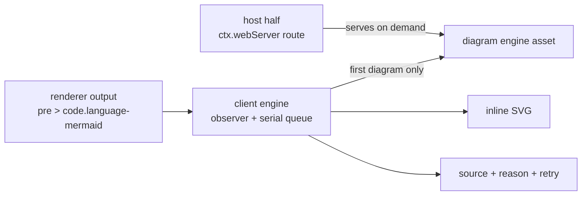

# dsh-plugin-markdown-plus

[简体中文](README.zh-CN.md) | English

**Markdown+** — a one-stop Markdown enhancement plugin for [DeepSeek Harness](https://github.com/deepseek-ai/deepseek-harness) Web.

One plugin instead of five. Every enhancement follows the same contract: **idempotent**, **lazy**, **zero runtime dependencies**, and **never leaves a blank block** — when a render fails you keep the source *and* get a readable reason plus a retry.

> Status: `0.1.0-beta` — the enhancement engine and the Mermaid module are in; outline (TOC), in-document search and more follow.

## Features

- **Mermaid diagrams.** ```mermaid fences (also `mermaidjs` / `mmd`) render to inline SVG; blocks without a language class are recognised by their first keyword, which covers the plain-`<code>` fallback.
- **Visible degradation, never a blank block.** Syntax errors, engine load failures and oversized sources each keep the original source in place, state the reason, and offer retry.
- **Lazy by construction.** The diagram engine is bundled once into a separate asset served by the plugin's own host half and fetched only when the first diagram appears. `client.js` stays ~7 KB.
- **Streaming-safe.** A serial render queue yields between diagrams, and results that arrive after their block changed or left the document are discarded.
- **No runtime dependencies.** The engine is pinned in `devDependencies` and inlined at build time, so installing the plugin runs no dependency build scripts and needs no CDN.

## Install

```bash
dsh plugin --profile <profile> add @minonl/dsh-plugin-markdown-plus
```

## How it works

DSH does not expose a Markdown fence-render hook, so the plugin enhances the rendered DOM:



The host half is a real plugin entry (it registers a route through `ctx.webServer`), which is what makes the browser half reachable at all; the browser half registers its module factory through `window.__ModuleLoader__` and starts on materialisation.

## Development

```bash
bun install
bun run build      # host (ESM) + client (IIFE, wrapped) + lazy engine asset, with build self-checks
bun run typecheck
bun test           # DOM-level tests (happy-dom)
```

Design and contracts: [docs/design.md](docs/design.md). Agent guidance: [AGENTS.md](AGENTS.md).

## License

MIT
