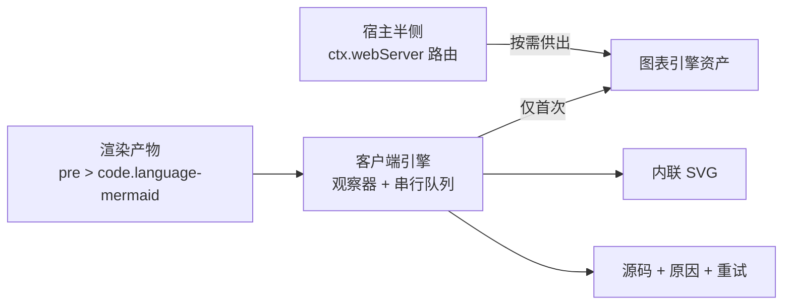

# dsh-plugin-markdown-plus

简体中文 | [English](README.md)

**Markdown+** —— 面向 [DeepSeek Harness](https://github.com/deepseek-ai/deepseek-harness) Web 的**一站式** Markdown 增强插件。

装一个顶五个。所有增强点共用同一套契约：**幂等**、**懒加载**、**零运行时依赖**，并且**永远不留空白块**——渲染失败时源码照旧可读，同时给出原因与重试。

> 状态：`0.1.0-beta` —— 增强引擎与 Mermaid 模块已完成；大纲（TOC）、文档内搜索等随后跟进。

## 能力

- **Mermaid 图表**：```mermaid 围栏（含 `mermaidjs` / `mmd`）渲染为内联 SVG；无语言类的代码块按源码首词识别（覆盖宿主退化成纯 `<code>` 的情况）。
- **降级可见，绝不留空白块**：语法错误 / 引擎加载失败 / 超大源码各自保留源码、说明原因、提供重试。
- **构造即懒加载**：图表引擎单独构建为一份资产，由插件宿主半侧按需供出，**首次出现图表时**才拉取；`client.js` 仅约 13 KB。
- **流式安全**：串行渲染队列逐图让出主线程；渲染完成后若节点已变或已离开文档，结果直接丢弃。
- **零运行时依赖**：引擎精确锁定在 `devDependencies` 并于构建期内联，安装不触发依赖构建脚本，也不依赖任何 CDN。

## 安装

```bash
dsh plugin --profile <profile> add @minonl/dsh-plugin-markdown-plus
```

预发布版本走 `experimental` dist-tag（由 `publish` 工作流手动发布，可能不稳定）：

```bash
dsh plugin --profile <profile> add @minonl/dsh-plugin-markdown-plus@experimental
```

## 工作原理

DSH 未开放 Markdown 围栏渲染钩子，因此插件在渲染产物上做增强：



宿主半侧是**真实激活**的插件条目（通过 `ctx.webServer` 注册路由），这是浏览器半侧能被请求到的前提；浏览器半侧通过 `window.__ModuleLoader__` 注册模块工厂，并在物化时启动。

## 开发

```bash
bun install
bun run build      # 宿主(ESM) + 客户端(IIFE 包装) + 惰性引擎资产，含产物自检
bun run typecheck
bun test           # DOM 级测试（happy-dom）
```

设计与契约见 [docs/design.md](docs/design.md)；协作指引见 [AGENTS.md](AGENTS.md)。

## 许可证

MIT
