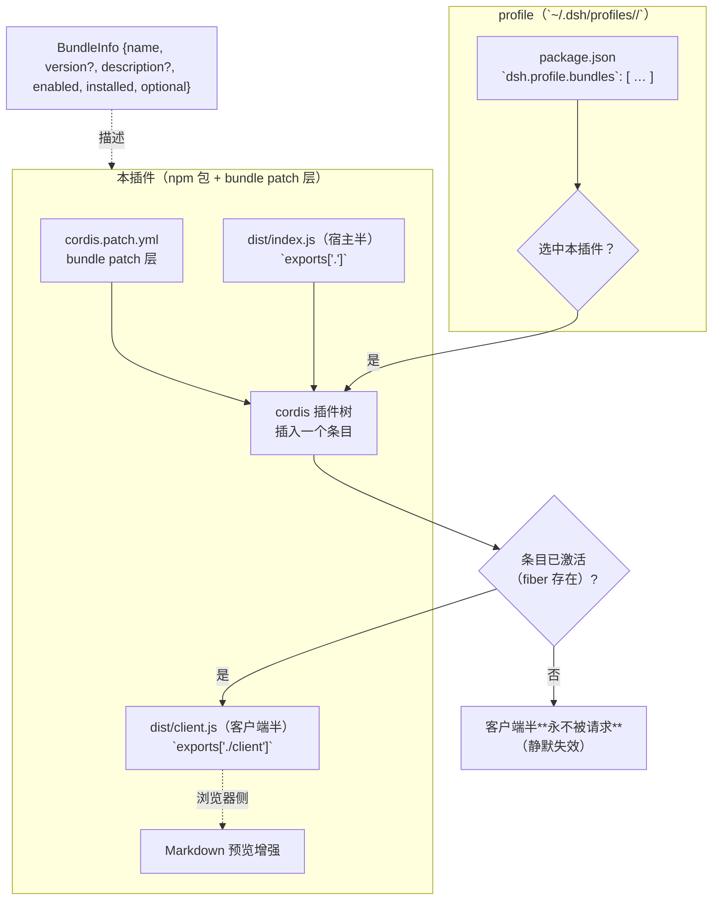
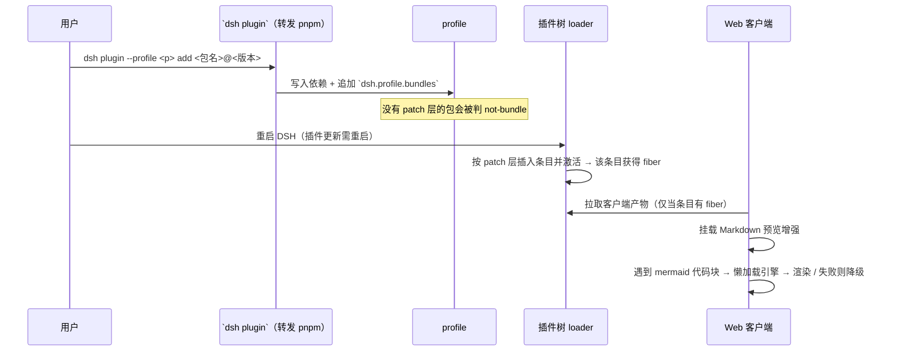
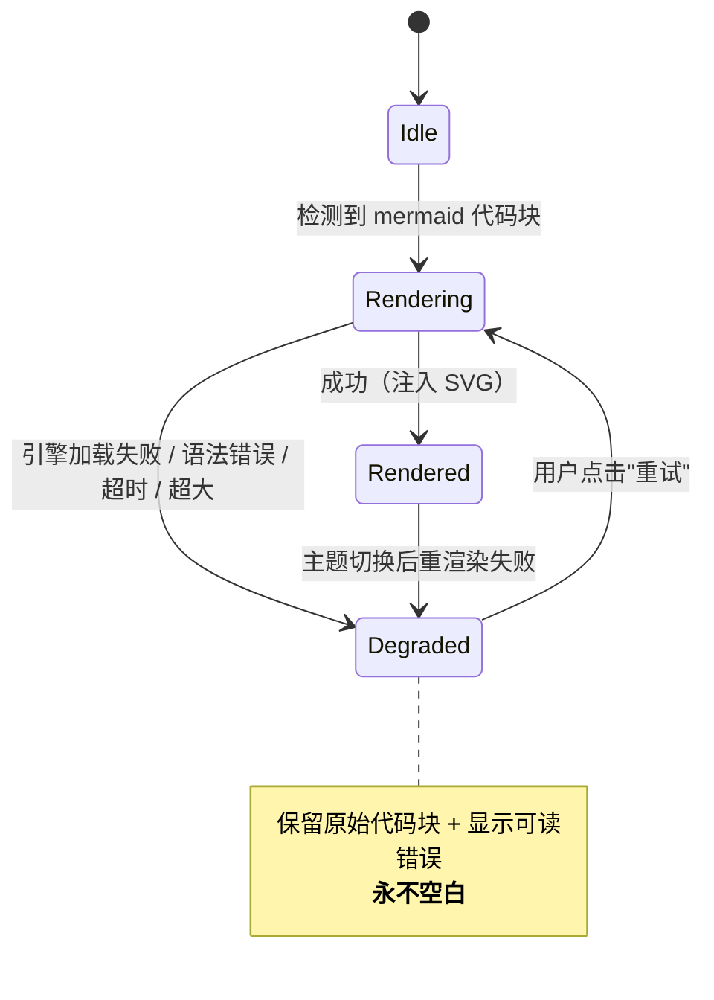
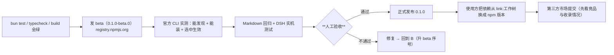
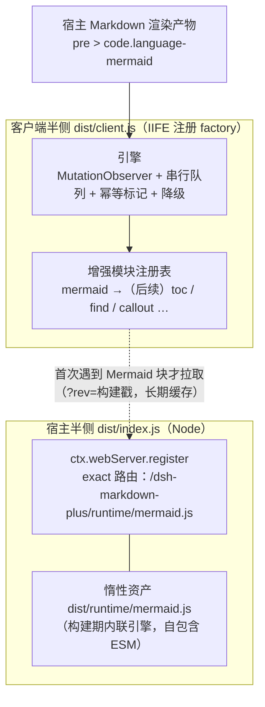

# 设计文档 — dsh-plugin-markdown-plus

> 状态：**设计定稿（待实现）**｜最后更新：2026-10-16
> 仓库：`github.com/minonl/dsh-plugin-markdown-plus`（public）｜包名：`@minonl/dsh-plugin-markdown-plus`
> 目标读者：实现者 / 评审者 / 未来的贡献者。**本仓库为公开仓：不得出现任何内部标识、内部路径或凭据**（见 `AGENTS.md`）。

---

## 1. 目标与非目标

### 目标
在 **DeepSeek Harness（DSH）** 的 Markdown 预览里渲染 **Mermaid 图**，并且**渲染失败时永远保留可读内容**（源码 + 明确提示），**绝不出现空白块**。

### 非目标（v1 明确不做）
- ❌ 不做完整 Markdown 渲染器（DSH 自带渲染；本插件只做**增强**）
- ❌ 不做 KaTeX / 代码高亮（宿主已有）
- ❌ 不做主题系统（跟随宿主主题）
- ❌ 不做服务端渲染 / 网络请求（纯前端增强）
- ❌ 不做图表以外的可视化（仅 Mermaid）

---

## 2. 概念与关系

DSH 的插件模型（官方语义，来自官方 `@deepseek-ai/dsh-plugin-manager` 类型）：



**三条关系（每条都曾造成事故）**：

| # | 关系 | 硬约束 |
|---|---|---|
| **R1** | 插件 = **npm 依赖 + bundle patch 层** | **没有 `dsh.bundle.patch`** 的依赖即便装上，选中时也会被判 **`not-bundle`（不生效）** |
| **R2** | 客户端半侧**只在宿主半侧"真激活"后**才会被请求 | 宿主半侧若是空实现（`apply(){}` 不接 ctx）⇒ 无 fiber ⇒ 客户端产物**永不被请求**（无报错，静默失效） |
| **R3** | 客户端半侧的模块（react 等）**由宿主模块表提供** | 客户端代码**不要 `import` 这些模块**——打包器会把它们内联成"第二份实例" ⇒ `Invalid hook call` 等运行期崩溃 |

---

## 3. 契约清单（实现与测试的唯一依据）

| # | 契约 | 内容 | 违反的后果 |
|---|---|---|---|
| **C1** | **客户端产物形态** | 产物必须能被宿主客户端加载器取用（官方装载机制）；**不得引用 `module` / `exports`** | 客户端激活失败：**整个 Web 界面打不开**（致命，不是局部坏） |
| **C2** | **宿主半侧可激活** | `exports["."]` 的模块导出 `name`（= 包名）+ 真使用 ctx 的 `apply(ctx)`；**不导出 `Config`** | 无 fiber ⇒ R2 ⇒ 静默失效 |
| **C3** | **包元数据** | `package.json`：`dsh.bundle.patch` 指向存在的 patch 文件；`exports["./client"]` 指向客户端产物；`dsh.client.platform = "web"` | `not-bundle` / `declares dsh.client but exports no "./client"` |
| **C4** | **patch 语义** | patch 文件用官方语法表达"插入一个条目"；**不得覆盖宿主行 config**（覆盖会整体替换配置） | 插入失败 / 触发宿主 HMR 使运行中会话失效 |
| **C5** | **降级可见** | 渲染失败、超时、超大文档一律 **保留源码 + 可见错误提示** | 空白块 = 用户以为文档为空（最差体验） |
| **C6** | **幂等** | 激活/挂载逻辑可重复执行而不产生重复注册、重复 DOM 或重复事件 | 多标签页/重载后出现双份渲染 |

> ✅ **C1 已钉死（2026-10-16，证据 = 官方 `@deepseek-ai/dsh-client-modules` README.zh，本机运行版 0.2.0-rc.2 内的副本）**：
> - 「宿主向 `<head>` 注入 **`window.__ModuleLoader__` queue facade**……执行插件 bundle **只注册其 factory**；
>    每个模块主体副作用（包括 CSS 注入）都位于 **factory 闭包**中，在物化时运行（`factory(require)` → 导出，在 `loadCache` 中记忆化）」
>   ⇒ 产物形态 = **`window.__ModuleLoader__.load({ id, factory: function (require) { … return exports } })`**；
>   **纯 ESM 不行**（`import/export` 无法放进 factory 函数体）。
> - 「该协议**只支持自包含 chunk**：入口与 chunk 产物**不能同步 require 另一个相对 `client*.js` 产物」⇒ **单文件**（不做 code splitting）。
> - 「浏览器插件包……以 `platform: 'web'` 声明 **`dsh.client`**，**导出 `./client` bundle**，并在 `dsh.client.external` 列出任何**基座之外**的模块请求」
>   ⇒ 必须补 `dsh.client`；只用宿主基座（React 等）时 `external: []` 即可。
> - 「外壳初始化一张**冻结的模块表** `PLATFORM_MODULES`（React、Cordis 与静态 UI 库）；每个动态 bundle 精确针对该基座解析其 external」
>   ⇒ 客户端代码**不要 `import` 基座模块**（会内联成第二份实例），经 **factory 的 `require`** 取用（R3）。
> - 「宿主提供的是**已构建**的客户端 bundle……**缺失 bundle 会明确导致激活失败**，并给出构建说明及包/路径列表」⇒ 缺产物是**响亮失败**（好）。
>
> **本仓库已按此改造**：宿主半 `vite.config.ts`（ESM → `dist/index.js`）＋ 客户端半 `vite.client.config.ts`（IIFE）＋
> `scripts/build.mjs` 负责**包装成注册形式**并做产品自检（禁 `module.exports`、禁 ESM 语法、校验注册 id 与包名一致）。
> 仍待 **G2（实机验证客户端半侧真的被请求）**——那是发布 beta 前的闸门。

---

## 4. 流程

### 4.1 安装 → 激活 → 渲染



### 4.2 客户端渲染状态机（C5 的核心）



### 4.3 发布流程（发布顺序，见 §6）



---

## 5. 边界与异常

| # | 场景 | 期望行为 |
|---|---|---|
| E1 | Mermaid 语法错误 | 降级：源码照常可读 + "语法错误"提示（含 Mermaid 返回的首行错误） |
| E2 | 引擎加载失败（网络/资源） | 降级 + 可重试；**不阻塞**其它内容渲染 |
| E3 | 超大图 / 超大文档 | 超过阈值不自动渲染，显示"点此渲染"（避免主线程卡死） |
| E4 | 主题切换 | 已渲染图按新主题重渲染；失败则退回降级态 |
| E5 | 宿主半侧未激活（R2） | **必须被发现**：装机后的自检项（见 §7 G2），不能"装了但没生效" |
| E6 | 多标签页 / 多次挂载 | 幂等（C6）：无重复注册、无重复 DOM |
| E7 | 宿主不提供预期服务 | 客户端半侧**降级为只读行为**（不抛错、不白屏） |
| E8 | 版本/产物不一致 | 渲染面板角落显示**构建标识**（build id），便于判断"跑的是哪一版" |
| E9 | 发布时忘了构建 | `prepublishOnly` 闸门（build + test），避免用户装到空壳 |
| E10 | 默认 registry 是镜像 | 发布**必须**显式指向 `https://registry.npmjs.org`（镜像通常不接受发布） |

---

## 6. 测试策略

| 层 | 内容 | 判据 |
|---|---|---|
| **类型** | `bun run typecheck` | 0 错误 |
| **单元** | 渲染成功 / 降级 / 幂等（三态各至少 1 例） | `bun test` 全绿 |
| **契约** | C1–C6 的**可执行**检查（不是只读字符串）：① 产物不引用 `module`/`exports` ② 宿主半侧 `apply(ctx)` 真用 ctx ③ `dsh.bundle.patch` 指向存在文件 ④ `exports["./client"]` 存在 ⑤ 幂等：连续 setup 两次无重复 | 契约检查脚本非 0 退出即失败 |
| **实机** | 官方 CLI 安装 + 打开 `.md` 目视 | §7 的 G1/G2 闸门 |
| **回归** | 既有 Markdown 文档渲染不受影响 | 抽查 3–5 篇真实文档（含无 mermaid、单图、多图、语法错误） |

> **反例自证**：契约检查必须能被"故意造坏"的夹具证伪（造坏产物/坏宿主必须报错），否则是"永远绿"的假检查。

---

## 7. 闸门（发布前必须过，不得跳步）

| 闸门 | 内容 | 为什么 |
|---|---|---|
| **G1** | ~~客户端产物形态钉死~~ **✅ 已钉死（2026-10-16，官方 README 取证）+ 构建管线已改造** | 形态错 ⇒ 整个界面打不开（致命） |
| **G2** | 装机后自检"**客户端半侧是否真的被请求/生效**" | R2 是**静默**失效，只有主动检查才发现 |
| **G3** | beta 包安装实测（`dsh plugin add @minonl/dsh-plugin-markdown-plus@0.1.0-beta.0`） | 官方通道能否"发现+安装+选中生效" |
| **G4** | 人工验收（用户） | 对外发布不可逆 |

---

## 8. 发布顺序（含人工环节）

1. 本地：`bun run typecheck` + `bun test` + `bun run build` 全绿；
2. **beta 发布**（registry 指向 npmjs）：
   ```bash
   npm publish --registry=https://registry.npmjs.org --tag beta
   # 或 scope 定向（不影响其它包）：~/.npmrc 加 `@minonl:registry=https://registry.npmjs.org/`
   ```
3. 官方 CLI 实测：`dsh plugin --profile <p> add @minonl/dsh-plugin-markdown-plus@0.1.0-beta.0`（含"选中后生效"）；
4. Markdown 回归 + DSH 实机目视；
5. **⏸ 人工验收（用户）** —— 通过前**不得**正式发布；
6. 正式发布 `0.1.0`（去掉 beta tag）；
7. 使用方把该插件的依赖从 `link:<工作树>` 改为 **npm 版本引用**（版本化，不再随工作树漂移）；
8. 第三方市场：**先看竞品/收录情况**，评估是否需要功能增强，再打 topic（`dsh-plugin` 等）并提交。

---

## 9. 风险与待决项

| # | 项 | 状态 | 备注 |
|---|---|---|---|
| P1 | **客户端产物形态**（ESM vs 需要包装） | ⚠️ **待实测（G1）** | 当前配置产出 ESM；发布前必须用官方装载器钉死 |
| P2 | 仓名 `dsh-plugin-markdown-plus` 与包名 `@minonl/dsh-plugin-markdown-plus` 是否统一 | 🟡 **待用户确认** | 发布前改名零成本；改名面仅 3 处（package.json / README / lock） |
| P3 | Mermaid 版本策略 | ✅ 定：**精确锁定**，且放 `devDependencies`（构建期内联） | 渲染行为随小版本漂移；运行时零依赖 |
| P4 | 是否做分块（引擎懒加载独立 chunk） | v1 **不做**（单文件自包含） | 契约只支持自包含 chunk；体积优化列 v1.1 |
| P6 | **v1 范围** | ✅ 定：**一站式 Markdown Plus**（见 §11） | 市场单功能件高度拥挤，取"整合 + 质量"差异化 |
| P7 | 惰性运行时体积（当前 7.4 MB / gzip 1.7 MB） | ⏳ v1.1 优化 | 懒加载 + 不可变缓存已缓解；后续考虑精简图表集 |
| P5 | 大文档阈值 | 建议可配置 + 保守默认 | 见 E3 |

---

## 10. 技术路线取证与依赖策略（2026-10-16 补齐，均来自官方源码/公开生态）

### 10.1 接入方式：**DOM 增强**（官方没有 Markdown 代码块扩展点）

官方 Markdown 渲染在 `@deepseek-ai/dsh-client-ui-primitives` 的 `MarkdownText`（micromark 解析 + KaTeX + Shiki 高亮 + 流式缓存）。
其对外 API 为 `MarkdownText` / `MarkdownDelegateProvider` / `CodeBlock` / `languageForPath` / `CODE_HIGHLIGHT_EXTENSIONS` / `useCodeHighlighter`——
**不含"自定义围栏渲染器"钩子**（`MarkdownDelegateProvider` 只委托链接打开与文件打开）。

⇒ 结论：插件**无法**从官方渲染管线内部注册 Mermaid 渲染器；可行路线是**在其渲染产物上做 DOM 增强**：
监听 `<pre><code class="language-mermaid">`（含无语言类但有 mermaid 关键字的兜底），替换为 SVG；失败则**保留源码并显示可读提示**（C5）。
该路线为生态通行做法（市场同类插件同样只增强 `<pre><code>`、忽略行内代码）。

### 10.2 依赖策略：**运行时零依赖，渲染引擎内联进客户端产物**

| 位置 | 内容 | 理由 |
|---|---|---|
| `dependencies` | **无** | 装插件不触发依赖脚本（规避 pnpm 11 依赖脚本门 `pendingBuilds`/`approvedBuilds` 的批准流程） |
| `devDependencies` | `mermaid`（**精确锁定版本**）+ 构建工具 | 引擎在**构建期**打进自包含客户端产物，符合"入口与 chunk 必须自包含"契约 |
| `peerDependencies` | 无 | 基座模块（React/Cordis/静态 UI）由宿主冻结模块表提供，**不声明、不打包** |

### 10.3 竞品事实（公开市场，用于定位与差异化判断）

| 同类插件 | 规模 | 覆盖 |
|---|---|---|
| `dsh-mermaid` | ★13 / npm `dsh-mermaid@0.4.2` | Mermaid 渲染**全套**：Code/Diagram 切换、失败回源码、懒加载、串行队列、50k 字符 / 2000 行保护、主题、全屏 + 缩放、SVG 导出、中英 i18n、a11y、流式防串号；**0 开放 issue** |
| `dsh-better-markdown` | ★20 / npm 已发 | 用第三方 `markstream-react` **替换整条流式渲染链路** |
| `dsh-diagram` | ★18 | Excalidraw 画布 |
| `dsh-chat-toc` / `dsh-quick-toc` | ★3 / ★1 | 会话大纲（TOC） |
| `dsh-find-viewer` | ★0 | 侧栏文本查找条 |
| `dsh-conv-export` / `dsh-md-export` | ★8 / ★1 | 导出 MD / PDF |
| 市场同类规模 | `markdown` 400 仓、**`mermaid` 62 仓**、`toc` 12 仓 | 单功能赛道高度拥挤 |

⇒ **差异化只能在"整合 + 质量"上取**（一站式覆盖多个单功能点；以及本仓已有的契约自检 / 官方契约钉死 / 一致的降级体验），
而**不是**在"Mermaid 能否渲染"上。

---

## 11. v1 范围与实现架构（2026-10-16 定案：**一站式 Markdown Plus**）

### 11.1 定位

市场同类是**单功能小插件**（`markdown` 相关 400 仓、Mermaid 单一功能 62 仓、TOC / 搜索 / 导出各有零星实现，多为 ★0–3）。
本插件取**整合 + 质量**差异化：**一个插件覆盖多个增强点**，且每个增强点都遵守同一套
「**幂等 · 降级可见 · 懒加载 · 零运行时依赖**」契约（见 §3 / §5）。

### 11.2 架构



要点：

| 关注点 | 做法 | 依据 |
|---|---|---|
| 宿主激活 | `inject = ['webServer']` + `ctx.effect(() => ctx.webServer.register(...))` | 官方 `dsh-host-webserver`：`register` 返回 disposer；空实现会导致客户端产物**永不被请求**（R2） |
| 引擎内联 | 引擎打进**独立惰性资产**（非 client.js），由宿主按需供出 | 产物自包含契约 + client.js 保持轻量（当前 7 KB vs 资产 7.4 MB） |
| 缓存 | 资产路径带 `?rev=<build>`，响应 `immutable` | 官方同类做法（revision 变更即失效） |
| 增强方式 | 官方**没有** Markdown 围栏扩展点 ⇒ DOM 增强（见 §10.1） | 官方 `ui-primitives` 只暴露 `MarkdownText`/`CodeBlock`，无渲染钩子 |
| 幂等 | 节点标记 `data-mdp-state` + 源码比对 + 引擎单例 | 流式输出会反复重渲染同一段 DOM |
| 降级 | 保留源码 + 可读提示 + **恒有**重试按钮；引擎加载失败/语法错误/超大源码分别给出原因 | C5：永不留空白块 |
| 依赖 | 运行时 **0 依赖**；`mermaid` 精确锁在 devDependencies | 规避 pnpm 11 依赖脚本授权流程（§10.2） |

### 11.3 模块接口（新增增强点的唯一扩展点）

```ts
interface EnhanceModule {
  readonly id: string;
  test(block: HTMLPreElement, ctx: EnhanceContext): boolean;      // 是否接管
  enhance(block: HTMLPreElement, ctx: EnhanceContext): void | Promise<void>; // 执行（失败自行降级）
  dispose?(): void;
}
```

### 11.4 路线

| 版本 | 内容 | 目的 |
|---|---|---|
| `0.1.0-beta.0` | 引擎 + **Mermaid**（本轮） | **打通官方通道**（npm 发布 + `dsh plugin add` + 选中生效），验证客户端契约与降级表现 |
| `0.1.0` | 同上，按验收意见收口 | 首个正式版 |
| `0.2.0` | + **大纲/锚点（TOC）** | 一站式第二块（市场现有实现均为 ★0–3 的单功能件） |
| `0.3.0` | + **文档内搜索/高亮** | 同上 |
| `0.4.0+` | + callout/脚注、表格增强、导出（按需求排序） | 补齐「一个顶五个」 |
| `1.0.0` | 市场提交（先复核竞品与收录要求） | §8 第 8 步 |

### 11.5 已验证 / 待验证

| 项 | 状态 |
|---|---|
| 三段构建（宿主 ESM / 客户端 IIFE 包装 / 惰性运行时 ESM）+ 产物自检 | ✅ 通过（禁止 `module.exports`、校验注册 id、校验宿主注册了 webServer、校验资产自包含且已内联引擎） |
| 单测：识别（语言类 + 无语言类兜底）、渲染成功、语法错误降级、引擎加载失败降级、超大源码降级、幂等、防串号、引擎幂等、降级重试 | ✅ 11 用例 / 35 断言 |
| 实机 · 安装与组合（`dsh plugin add <绝对路径>`，隔离 profile） | ✅ 通过：pnpm 以 `link:` 装入、**自动追加进 `dsh.profile.bundles`**；`--dump-config` 中条目在位（非 `not-bundle`） |
| 实机 · 宿主半侧激活（G2 前半） | ✅ 通过：`GET /dsh-markdown-plus/runtime/mermaid.js` → `200`、**7,717,526 字节**、`text/javascript` |
| 实机 · 客户端半侧被请求（G2 后半） | ✅ 通过：`window.__DSH_BOOT__` 启动图含本插件行（`{id, url, rev}`），组合脚本内含 `window.__ModuleLoader__.load({ id: "@minonl/dsh-plugin-markdown-plus" …})` |
| 实机 · 浏览器内真实渲染（无头 Chromium + 真实引擎 + 真实产物） | ✅ 通过：合法 flowchart → **1 个 SVG**（`viewBox="4.5 4 190 494"`，`width=100%`）、状态 `rendered`、源码折叠；语法错误 → `degraded` + 「Parse error on line 2」+ 源码保持可见；非图表块未误伤；无异常日志 |
| 浏览器真实页面内点击验证（DSH 外壳 UI） | ⏳ **人工验收（G4）**：需在 DSH 界面打开真实 `.md` 目视 |
| 运行时体积优化（7.4 MB → 精简图表集 / 分包） | ⏳ v1.1（P7） |
### 11.6 本地独立调试（vite dev，不依赖 DSH）

`bun run dev` 起一个独立的调试台（`http://localhost:5183/dev/harness.html`），用于**快速迭代增强逻辑**：

- 左侧编辑 Markdown，右侧即时看到增强结果；内置示例（混合 / 合法 / 语法错误 / 超大 / 纯文本）；
- `/src/**` 直接以 TS 源提供 ⇒ 改代码热更新，无需先构建产物；
- `/dsh-markdown-plus/runtime/mermaid.js` 由 vite 中间件**模拟宿主路由**（现场构建引擎、不写盘）⇒ 走的是与线上一致的"按需拉取"路径；
- 页面里的"宿主渲染模拟"刻意保留**无语言类的纯 `<code>`** 情形，用来验证兜底识别。

该目录只服务开发，不进入 npm 包（`files` 白名单不含 `dev/`）。

