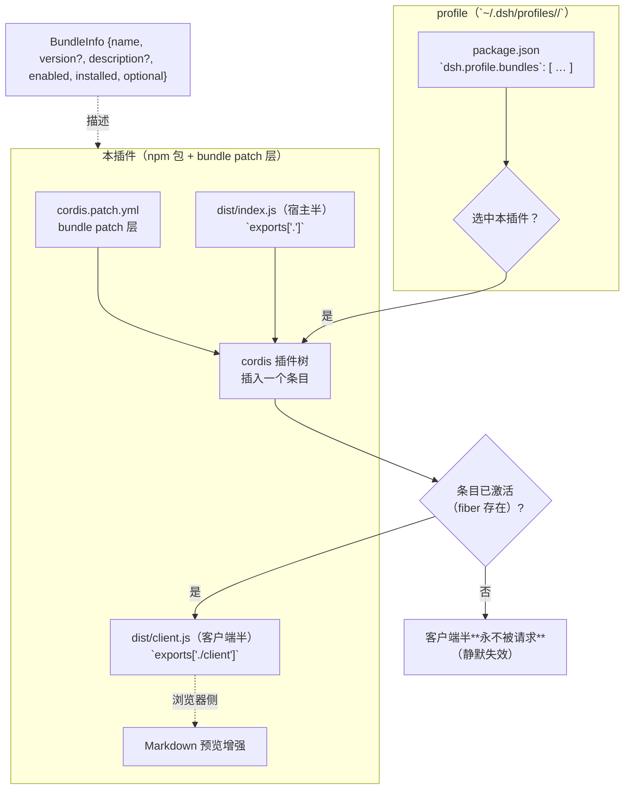
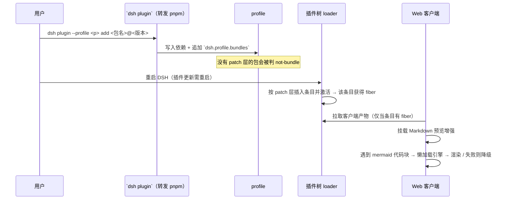
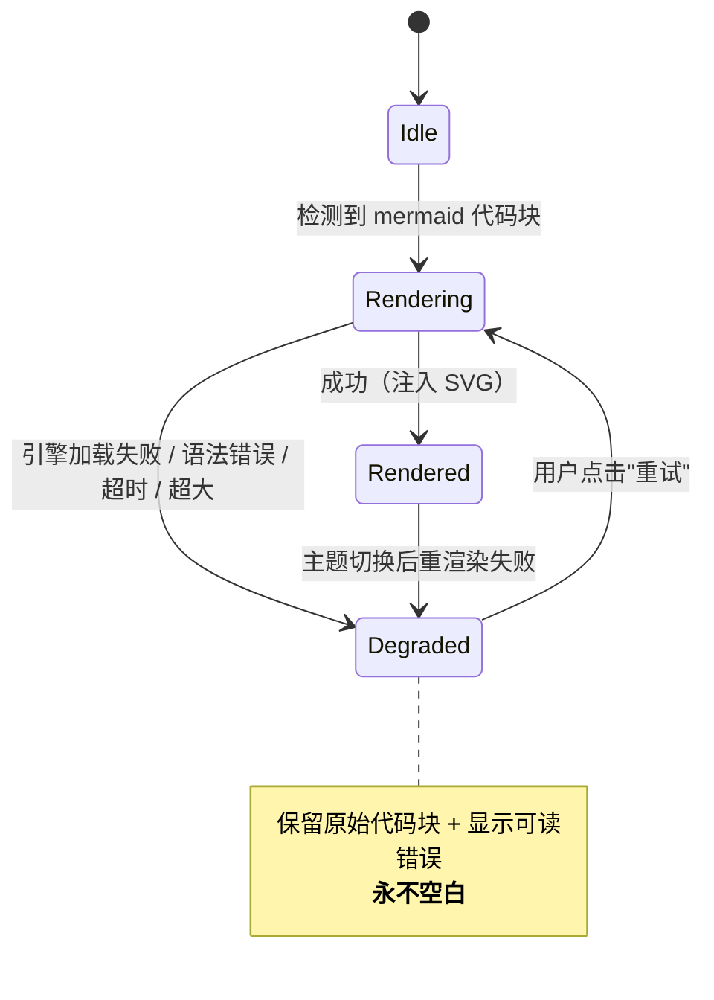
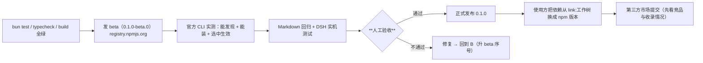

# 设计文档 — dsh-plugin-markdown-plus

> 状态：**设计定稿（待实现）**｜最后更新：2026-10-16
> 仓库：`github.com/minonl/dsh-plugin-markdown-plus`（public）｜包名：`@minonl/dsh-markdown-plus`
> 目标读者：实现者 / 评审者 / 未来的贡献者。**本仓库为公开仓：不得出现任何内部标识、内部路径或凭据**（见 `AGENTS.md`）。

---

## 1. 目标与非目标

### 目标
在 **DeepSeek Harness（DSH）** 的 Markdown 预览里渲染 **Mermaid 图**，并且**渲染失败时永远保留可读内容**（源码 + 明确提示），**绝不出现空白块**。

### 非目标（v1 明确不做）
- ❌ 不做完整 Markdown 渲染器（DSH 自带渲染；本插件只做**增强**）
- ❌ 不做 KaTeX / 代码高亮（宿主已有）
- ❌ 不做主题系统（跟随宿主主题）
- ❌ 不做服务端渲染 / 网络请求（纯前端增强）
- ❌ 不做图表以外的可视化（仅 Mermaid）

---

## 2. 概念与关系

DSH 的插件模型（官方语义，来自官方 `@deepseek-ai/dsh-plugin-manager` 类型）：



**三条关系（每条都曾造成事故）**：

| # | 关系 | 硬约束 |
|---|---|---|
| **R1** | 插件 = **npm 依赖 + bundle patch 层** | **没有 `dsh.bundle.patch`** 的依赖即便装上，选中时也会被判 **`not-bundle`（不生效）** |
| **R2** | 客户端半侧**只在宿主半侧"真激活"后**才会被请求 | 宿主半侧若是空实现（`apply(){}` 不接 ctx）⇒ 无 fiber ⇒ 客户端产物**永不被请求**（无报错，静默失效） |
| **R3** | 客户端半侧的模块（react 等）**由宿主模块表提供** | 客户端代码**不要 `import` 这些模块**——打包器会把它们内联成"第二份实例" ⇒ `Invalid hook call` 等运行期崩溃 |

---

## 3. 契约清单（实现与测试的唯一依据）

| # | 契约 | 内容 | 违反的后果 |
|---|---|---|---|
| **C1** | **客户端产物形态** | 产物必须能被宿主客户端加载器取用（官方装载机制）；**不得引用 `module` / `exports`** | 客户端激活失败：**整个 Web 界面打不开**（致命，不是局部坏） |
| **C2** | **宿主半侧可激活** | `exports["."]` 的模块导出 `name`（= 包名）+ 真使用 ctx 的 `apply(ctx)`；**不导出 `Config`** | 无 fiber ⇒ R2 ⇒ 静默失效 |
| **C3** | **包元数据** | `package.json`：`dsh.bundle.patch` 指向存在的 patch 文件；`exports["./client"]` 指向客户端产物；`dsh.client.platform = "web"` | `not-bundle` / `declares dsh.client but exports no "./client"` |
| **C4** | **patch 语义** | patch 文件用官方语法表达"插入一个条目"；**不得覆盖宿主行 config**（覆盖会整体替换配置） | 插入失败 / 触发宿主 HMR 使运行中会话失效 |
| **C5** | **降级可见** | 渲染失败、超时、超大文档一律 **保留源码 + 可见错误提示** | 空白块 = 用户以为文档为空（最差体验） |
| **C6** | **幂等** | 激活/挂载逻辑可重复执行而不产生重复注册、重复 DOM 或重复事件 | 多标签页/重载后出现双份渲染 |

> ⚠️ **C1 的形态在本仓尚未钉死**：当前 `vite.config.ts` 产出 **ESM**（`formats:['es']`）。
> 官方客户端装载对产物形态有具体要求（可能要求特定的包装/IIFE 形式）。
> **这必须在发布 beta 之前用官方装载器实测钉死**（列为 §7 的第一道闸门 G1）——**不得凭猜测发布**。

---

## 4. 流程

### 4.1 安装 → 激活 → 渲染



### 4.2 客户端渲染状态机（C5 的核心）



### 4.3 发布流程（发布顺序，见 §6）



---

## 5. 边界与异常

| # | 场景 | 期望行为 |
|---|---|---|
| E1 | Mermaid 语法错误 | 降级：源码照常可读 + "语法错误"提示（含 Mermaid 返回的首行错误） |
| E2 | 引擎加载失败（网络/资源） | 降级 + 可重试；**不阻塞**其它内容渲染 |
| E3 | 超大图 / 超大文档 | 超过阈值不自动渲染，显示"点此渲染"（避免主线程卡死） |
| E4 | 主题切换 | 已渲染图按新主题重渲染；失败则退回降级态 |
| E5 | 宿主半侧未激活（R2） | **必须被发现**：装机后的自检项（见 §7 G2），不能"装了但没生效" |
| E6 | 多标签页 / 多次挂载 | 幂等（C6）：无重复注册、无重复 DOM |
| E7 | 宿主不提供预期服务 | 客户端半侧**降级为只读行为**（不抛错、不白屏） |
| E8 | 版本/产物不一致 | 渲染面板角落显示**构建标识**（build id），便于判断"跑的是哪一版" |
| E9 | 发布时忘了构建 | `prepublishOnly` 闸门（build + test），避免用户装到空壳 |
| E10 | 默认 registry 是镜像 | 发布**必须**显式指向 `https://registry.npmjs.org`（镜像通常不接受发布） |

---

## 6. 测试策略

| 层 | 内容 | 判据 |
|---|---|---|
| **类型** | `bun run typecheck` | 0 错误 |
| **单元** | 渲染成功 / 降级 / 幂等（三态各至少 1 例） | `bun test` 全绿 |
| **契约** | C1–C6 的**可执行**检查（不是只读字符串）：① 产物不引用 `module`/`exports` ② 宿主半侧 `apply(ctx)` 真用 ctx ③ `dsh.bundle.patch` 指向存在文件 ④ `exports["./client"]` 存在 ⑤ 幂等：连续 setup 两次无重复 | 契约检查脚本非 0 退出即失败 |
| **实机** | 官方 CLI 安装 + 打开 `.md` 目视 | §7 的 G1/G2 闸门 |
| **回归** | 既有 Markdown 文档渲染不受影响 | 抽查 3–5 篇真实文档（含无 mermaid、单图、多图、语法错误） |

> **反例自证**：契约检查必须能被"故意造坏"的夹具证伪（造坏产物/坏宿主必须报错），否则是"永远绿"的假检查。

---

## 7. 闸门（发布前必须过，不得跳步）

| 闸门 | 内容 | 为什么 |
|---|---|---|
| **G1** | 用官方装载机制实测**客户端产物形态**（C1）钉死；必要时改构建配置（IIFE/包装） | 形态错 ⇒ 整个界面打不开（致命） |
| **G2** | 装机后自检"**客户端半侧是否真的被请求/生效**" | R2 是**静默**失效，只有主动检查才发现 |
| **G3** | beta 包安装实测（`dsh plugin add @minonl/dsh-markdown-plus@0.1.0-beta.0`） | 官方通道能否"发现+安装+选中生效" |
| **G4** | 人工验收（用户） | 对外发布不可逆 |

---

## 8. 发布顺序（含人工环节）

1. 本地：`bun run typecheck` + `bun test` + `bun run build` 全绿；
2. **beta 发布**（registry 指向 npmjs）：
   ```bash
   npm publish --registry=https://registry.npmjs.org --tag beta
   # 或 scope 定向（不影响其它包）：~/.npmrc 加 `@minonl:registry=https://registry.npmjs.org/`
   ```
3. 官方 CLI 实测：`dsh plugin --profile <p> add @minonl/dsh-markdown-plus@0.1.0-beta.0`（含"选中后生效"）；
4. Markdown 回归 + DSH 实机目视；
5. **⏸ 人工验收（用户）** —— 通过前**不得**正式发布；
6. 正式发布 `0.1.0`（去掉 beta tag）；
7. 使用方把该插件的依赖从 `link:<工作树>` 改为 **npm 版本引用**（版本化，不再随工作树漂移）；
8. 第三方市场：**先看竞品/收录情况**，评估是否需要功能增强，再打 topic（`dsh-plugin` 等）并提交。

---

## 9. 风险与待决项

| # | 项 | 状态 | 备注 |
|---|---|---|---|
| P1 | **客户端产物形态**（ESM vs 需要包装） | ⚠️ **待实测（G1）** | 当前配置产出 ESM；发布前必须用官方装载器钉死 |
| P2 | 仓名 `dsh-plugin-markdown-plus` 与包名 `@minonl/dsh-markdown-plus` 是否统一 | 🟡 **待用户确认** | 发布前改名零成本；改名面仅 3 处（package.json / README / lock） |
| P3 | Mermaid 版本策略 | 建议**精确锁定** | 渲染行为随小版本漂移（尺寸/字体），精确锁定便于复现问题 |
| P4 | 是否做分块（引擎懒加载独立 chunk） | v1 **不做** | 单文件优先保证正确性；体积优化列为 v1.1 |
| P5 | 大文档阈值 | 建议可配置 + 保守默认 | 见 E3 |
