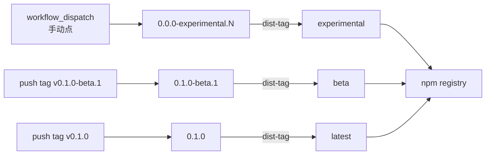

# 发布流程

本包通过 **npm Trusted Publishing（OIDC）** 发布：CI 用短期身份令牌换发布权限，
**不需要长期 token，也不需要手动输入 OTP**。

## 两条通道（同一个 workflow 文件）

| 通道 | 触发 | 版本号 | dist-tag | 用途 |
|---|---|---|---|---|
| 实验包 | Actions 里手动 `workflow_dispatch` | `<base_version>-experimental.<run_number>`（默认 `0.0.0-experimental.N`） | `experimental` | 自测 / 给同事试装 / 验证真实 DSH 环境 |
| 预发布 | 推 tag `v0.1.0-beta.1` | 取 `package.json`，必须与 tag 一致 | `beta`（版本含 `-`） | 功能收口的候选版 |
| 正式 | 推 tag `v0.1.0` | 取 `package.json`，必须与 tag 一致 | `latest` | 对外可用 |



> **为什么两条通道共用一个 workflow 文件**：npm 的 Trusted Publisher 按**文件名**授权
> （`publish.yml`）。拆成两个文件就得维护两条授权，容易漂移。

> **版本号只在 CI 工作区里改**（`npm pkg set version=…`），不提交、不打 tag：
> 实验包的版本事实源是「这一次运行」，下一次运行自然更大。tag 通道反过来——tag 与
> `package.json` 不一致直接失败，防止 tag 与产物漂移。

## 一次性配置（在 npmjs.com 上，人工做一次）

1. 打开 <https://www.npmjs.com/package/@minonl/dsh-plugin-markdown-plus/access>（包创建后该页面才有）
2. **Trusted Publisher** → **Select your publisher** → **GitHub Actions**
3. 填入（**全部区分大小写，必须完全一致**）：

   | 字段 | 值 |
   |---|---|
   | Organization or user | `minonl` |
   | Repository | `dsh-plugin-markdown-plus` |
   | Workflow filename | `publish.yml` |
   | Environment name | （留空） |
   | Allowed actions | 勾选 **Allow npm publish** |

4. 保存。

> ⚠️ 新建的 Trusted Publisher 配置**必须在 2 天内完成首次成功发布**，否则过期作废。
> ⚠️ `package.json` 的 `repository.url` 必须与仓库完全一致（已配置为 `git+https://github.com/minonl/dsh-plugin-markdown-plus.git`）。

## 首次发布（尚无包时必须人工自举一次）

Trusted Publisher 要求包**已存在于 registry** 才能配置，所以第一次只能手工发：

```bash
# 在干净的主仓（main，已 pull）上操作，不提交任何改动
npm login                                          # 若未登录
npm pkg set version=0.0.0-experimental.0            # 只是让工作区 package.json 带上首发版本
npm publish --tag experimental --access public --otp=<认证器 6 位码>
git checkout -- package.json                        # 还原，别把自举版本提交进仓库
```

接着按上一节配好 Trusted Publisher，之后所有版本都走 CI。

## 发实验包（日常自测）

Actions → **publish** → **Run workflow**：

- Branch：默认 `main`；想验某个分支/PR 的改动，直接选那个分支（实验包就是拿来冒险的）
- `base_version`：默认 `0.0.0`。进入 `0.1.0` 迭代且要用 `0.1.0-experimental.N` 预演时改成 `0.1.0`

或命令行：

```bash
gh workflow run publish --ref main -f base_version=0.0.0
gh run watch
```

装它：

```bash
dsh plugin --profile <profile> add @minonl/dsh-plugin-markdown-plus@experimental
# 或精确到某次运行
dsh plugin --profile <profile> add @minonl/dsh-plugin-markdown-plus@0.0.0-experimental.7
```

> 实验包是 `0.0.0-…` 且只有 `experimental` dist-tag，所以**不会**影响
> `npm install @minonl/dsh-plugin-markdown-plus`（无 `latest` 时普通安装会失败——这是有意为之）。

## 发正式/预发布（tag 通道）

```bash
# 1) 改版本（语义化）
npm version 0.1.0 --no-git-tag-version
git commit -am "chore: v0.1.0"

# 2) 打 tag 并推送（tag 必须与 package.json 的 version 完全一致，CI 会校验）
git tag v0.1.0
git push origin main --tags

# 3) 等 CI 的 publish 工作流完成
gh run watch
```

## 发布后验证

```bash
# registry 上真的有了（CI 的 Verify 步骤也做这件事，失败会红）
npm view @minonl/dsh-plugin-markdown-plus versions dist-tags

# 装得进 profile、patch 真的生效
dsh plugin --profile <profile> add @minonl/dsh-plugin-markdown-plus@experimental
dsh --profile <profile> --dump-config | grep -A2 markdown-plus   # 条目在位 = bundle patch 生效
```

装完打开含 ```mermaid 围栏的文档，出图即通过；语法错误时应保留源码 + 提示 + 重试。

## 发布闸门（CI 与本地同一套）

| 步骤 | 命令 | 拦什么 |
|---|---|---|
| 类型 | `bun run typecheck` | 类型漂移 |
| 测试 | `bun test --preload ./test/preload.ts` | 行为回归（11 用例，DOM 级） |
| 构建 | `bun run build` | 三段产物 + 产物契约自检（`__ModuleLoader__` 注册、无 `module.exports`、引擎已内联） |
| 发包内容 | `node scripts/check-tarball.mjs` | tarball 缺文件 / 夹带源码测试 / 体积失守 |
| 发完核对 | `npm view <pkg>@<version>` | registry 上真的可安装 |

## 常见问题

| 现象 | 原因 | 处理 |
|---|---|---|
| `ENEEDAUTH` | workflow 文件名与 npmjs 配置不一致 | 核对必须是 `publish.yml`（含扩展名） |
| `E404` / 包不存在 | 首次发布还没自举 | 先按「首次发布」手工发一版，再配 Trusted Publisher |
| `id-token` 相关失败 | 缺 `id-token: write` | 工作流已配置，勿删 |
| OIDC 被静默跳过、PUT 返回 404 | npm < 11.5.1 | 工作流用 Node 24（npm ≥ 11） |
| `403 … cannot publish over the previously published version` | 这个版本号已经发过了（重跑同一个 run 会复用 `run_number`） | 重新点一次 Run workflow（新 run 号）或用 `base_version` 换基线 |
| tag 校验失败 | tag 与 `package.json` version 不一致 | 让两者一致后重新打 tag |
| 包能装但插件不生效 | `cordis.patch.yml` 没进 tarball | 跑 `node scripts/check-tarball.mjs` 看缺哪个文件 |

## 其它

- npm 账号被安全冻结期间（历史上发生过）CI 会 403：先按 [本地 registry 验证](local-registry-testing.md) 把安装路径跑通，解冻后再发。
- 构建产物（`.build/`、`*.tgz`）**不入库**：`dist/` 由 CI 现场构建，仓库只存源码。

## 备用通道：GitHub Release tarball（不依赖 npm）

npm 侧（2FA / 账号风控）不稳定时，用这条通道发布。它与 npm 通道**互不影响**，同一个 tag 会同时触发两条：

```bash
git tag v0.1.0-beta.1 && git push origin v0.1.0-beta.1
```

`release.yml` 会：构建 → 跑同一套闸门（typecheck / test / build / `check:tarball`）→
`npm pack` → 生成 `SHA256SUMS.txt` → 创建 GitHub Release 并附上 `.tgz`。

用户安装（官方 install-spec 的 `tarball` 形态，与 registry 安装等价）：

```bash
dsh plugin --profile <p> add \
  https://github.com/minonl/dsh-plugin-markdown-plus/releases/download/v0.1.0-beta.1/minonl-dsh-plugin-markdown-plus-0.1.0-beta.1.tgz
```

本地验证（已实测：`file:` 依赖 + bundle 选中 + patch 生效 + 运行时路由 200 + 启动图登记）：

```bash
npm pack --silent
dsh plugin --profile <p> add "$PWD"/minonl-dsh-plugin-markdown-plus-*.tgz
```

手动触发（不打 tag，只产出可下载的 CI 产物）：

```
Actions → release → Run workflow
```

### 三条通道对比

| 通道 | 触发 | 产物 | 需要 npm 账号 | 适用 |
|---|---|---|---|---|
| `publish.yml`（tag） | 推 `v*` | npm registry | 是（Trusted Publishing / 首次 bootstrap） | 正式对外 |
| `publish.yml`（dispatch） | 手动 | npm `experimental` 标签 | 是 | 自测 / 内部试装 |
| **`release.yml`** | 推 `v*` 或手动 | **GitHub Release `.tgz`** | **否** | npm 不可用时兜底 |

### npm 通道开关

npm 账号异常期间，tag 触发时 **跳过** npm 发布（避免红灯），tarball 通道照常工作：

```bash
gh variable set NPM_PUBLISH_ENABLED --body true     # 恢复 npm 发布
gh variable delete NPM_PUBLISH_ENABLED              # 暂停 npm 发布（默认）
```

手动触发（`workflow_dispatch` 实验包）不受该开关限制。
